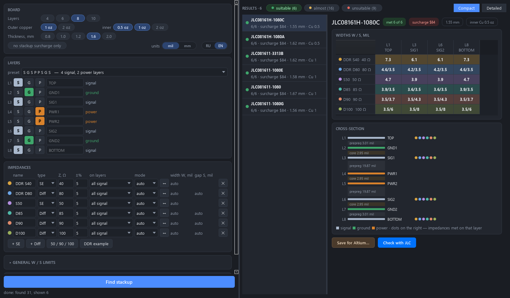

# JLCPCB Stackup Solver

Desktop tool that finds the cheapest **orderable JLCPCB stackup** for your impedances, computes
the trace widths and gaps for every signal layer, and exports the stack with the widths to
**Altium Designer** (`.stackup`, Windows) or **KiCad** (project, Linux/macOS). Works offline; an optional button checks the widths with
JLCPCB's own online Si9000 calculator. Interface in English and Russian.
Besides JLCPCB it knows the typical stackups of **Rezonit** (Russian PCB factory): one switch in the window.



## Download and run

**Current version: 1.2.1** (shown in the title of the program's window; earlier versions are on the [Releases](../../releases) page).

Download the ready program for your system, unpack it anywhere you can write to and start it.
Nothing to install, no Python needed.

| system | download (ready program) | start |
|---|---|---|
| **Windows** 10/11 x64 | **[JLCPCB-Stackup-Solver-v1.2.1-windows-x64.zip](https://github.com/ExaTek/JLCPCB_Stackup-Solver/releases/download/v1.2.1/JLCPCB-Stackup-Solver-v1.2.1-windows-x64.zip)** | unpack, run `JLCPCB-Stackup-Solver.exe` (SmartScreen: *More info → Run anyway*) |
| **Linux** x64, glibc 2.35+ (Ubuntu 22.04+, Debian 12+, Fedora 36+) | **[JLCPCB-Stackup-Solver-v1.2.1-linux-x64.tar.gz](https://github.com/ExaTek/JLCPCB_Stackup-Solver/releases/download/v1.2.1/JLCPCB-Stackup-Solver-v1.2.1-linux-x64.tar.gz)** | `tar xzf JLCPCB-Stackup-Solver-v1.2.1-linux-x64.tar.gz && ./JLCPCB-Stackup-Solver/JLCPCB-Stackup-Solver` |

> "Source code (zip / tar.gz)" on the [Releases](../../releases) page is added by GitHub
> automatically: that is the source, not the program.
```
JLCPCB-Stackup-Solver/
├── JLCPCB-Stackup-Solver(.exe)   the program
├── lib/                          Python, Qt, numpy/scipy
└── data/                         everything that changes
    ├── jlcpcb_stackups.zip       stack database: Settings → Update stack database
    ├── rezonit_stackups.zip      Rezonit's typical builds (same format, same button)
    ├── jlc_calc_cache.json       answers of JLC's online calculator
    └── settings.json, cache/, logs/   created by the program
```

The button at the top right of the **Board** block shows the version: green is the latest one, yellow **Update available** downloads and installs the new version and restarts the program. `data/` is kept: the refreshed stack database, settings and caches are not overwritten.

### From source (any OS with Python 3.10+)

```
git clone https://github.com/ExaTek/JLCPCB_Stackup-Solver && cd JLCPCB_Stackup-Solver
run.bat          # Windows
./run.sh         # Linux / macOS
```

The script creates `.venv` and installs `requirements.txt` on the first run
(by hand: `pip install -r requirements.txt`, then `python -m jlc`).

## What it does

- 4–10 layers, board thickness, outer/inner copper, layer roles (S / G / P) with presets.
- Impedance requirements: single-ended or differential, target Ω and tolerance, on which layers,
  auto-sized (smallest manufacturable W/S, JLC minimum 3.5/3.5 mil) or fixed geometry.
- Results grouped as *suitable / almost / unsuitable*, ranked by JLC's stackup surcharge
  (from the quote form, 5 pcs 100×100 mm); filter for stackups without surcharge.
- Windows: Altium export (Layer Stack Manager → File → Load Stackup): layers, dielectrics,
  solder mask, finish, impedance profiles `S50`, `DIFF90`, … with widths on every signal layer.
- Linux/macOS: KiCad 7+ project — `.kicad_pcb` with the stackup, `.kicad_pro` with net classes
  `S50`, `DIFF90`, …, `.kicad_dru` with the width and pair gap of every class on every signal layer.
  Open it, or pull it into your board with Board Setup → Import Settings.
- Stack database refresh from JLCPCB in Settings; mil ↔ mm; RU ↔ EN.
- Factory switch **JLCPCB / Rezonit**. Rezonit: its 29 typical builds from rezonit.ru (4/6/8 layers,
  foil 18 or 35 µm, FR-4 TG150/TG170, 1.0/1.5/2.0 mm) with Rezonit's Dk of cores, prepregs and mask;
  default minimum W/S is Rezonit's "advanced" class (0.10 mm for 18 µm, 0.15 mm for 35 µm foil).
  Rezonit does not publish plating, etch and mask thickness, so those follow JLC's model; with it the
  solver reproduces Rezonit's own 50 Ω / 100 Ω table within ±1.2 %. Inner layers are not verified
  against Rezonit (no published data).

The offline field solver matches JLC's Si9000 within ±0.3 % at equal inputs. JLC's calculator page itself
ignores the stack's Dk (fixed Er 4.3 / 4.2), so its widths differ on outer 1080 layers (see [details](docs/details.ru.md)).

## Repository

| folder | |
|---|---|
| `jlc/core` | stackup model, field solver, width search |
| `jlc/jlcpcb` | JLCPCB online API, stack database update, Si9000 answer cache |
| `jlc/rezonit` | Rezonit's typical builds from rezonit.ru into the same database format |
| `jlc/export` | Altium `.stackup` and KiCad project writers |
| `jlc/ui` | Qt window, RU/EN texts |
| `jlc/cli.py` | command line |
| `data` | stack databases (JLCPCB, Rezonit) and JLC answers shipped with the program |
| `packaging` | PyInstaller spec |
| `docs` | details (in Russian), screenshot, example export |

## Command line

```
python -m jlc list   --layers 8 --thick 1.6 [--inner 0.5] [--free]
python -m jlc widths JLC081611-1080B [--se 40,50] [--diff 80,90,100] [--online]
python -m jlc update                 # refresh data/jlcpcb_stackups.zip (~7 min)
python -m jlc list --fab rezonit --layers 6   # Rezonit's typical builds (data/rezonit_stackups.zip)
python -m jlc update --fab rezonit   # re-read them from rezonit.ru (seconds)
python -m jlc --help
```

## Build

```
pip install -r requirements.txt pyinstaller
pyinstaller --noconfirm packaging/JLCPCB-Stackup-Solver.spec    # -> dist/JLCPCB-Stackup-Solver/
dist/JLCPCB-Stackup-Solver/JLCPCB-Stackup-Solver --selftest     # headless check, exit code 0 = ok
```

GitHub Actions builds and self-tests both versions on every push; a `v*` tag publishes a release.

## Notes

Not affiliated with or endorsed by JLCPCB or Rezonit. The stack databases are public data from
JLCPCB's impedance calculator and quote form and from rezonit.ru; prices and stackups change, so
check the final order with the factory.

---

**Кратко по-русски.** Программа подбирает самый дешёвый заказываемый стек JLCPCB под нужные
импедансы, считает ширины и зазоры на всех сигнальных слоях и сохраняет стек с профилями
импеданса для Altium Designer (Windows) или проект KiCad (Linux/macOS). Текущая версия — **1.2.1**. Скачайте готовую программу по ссылке из таблицы [Download and run](#download-and-run) (не «Source code»),
распакуйте и запустите — установка не нужна. Папка `data/` рядом с программой хранит базу стеков
(обновляется в «Настройках»), настройки, кэш и журналы. Интерфейс переключается кнопкой RU/EN.
Переключатель «Завод» вверху формы даёт вместо JLCPCB типовые сборки **Резонита** (4/6/8 слоёв,
фольга 18/35 мкм, TG150/TG170) с их Dk и минимальными ширинами.
Подробности — в [docs/details.ru.md](docs/details.ru.md).

## License

[MIT](LICENSE)
